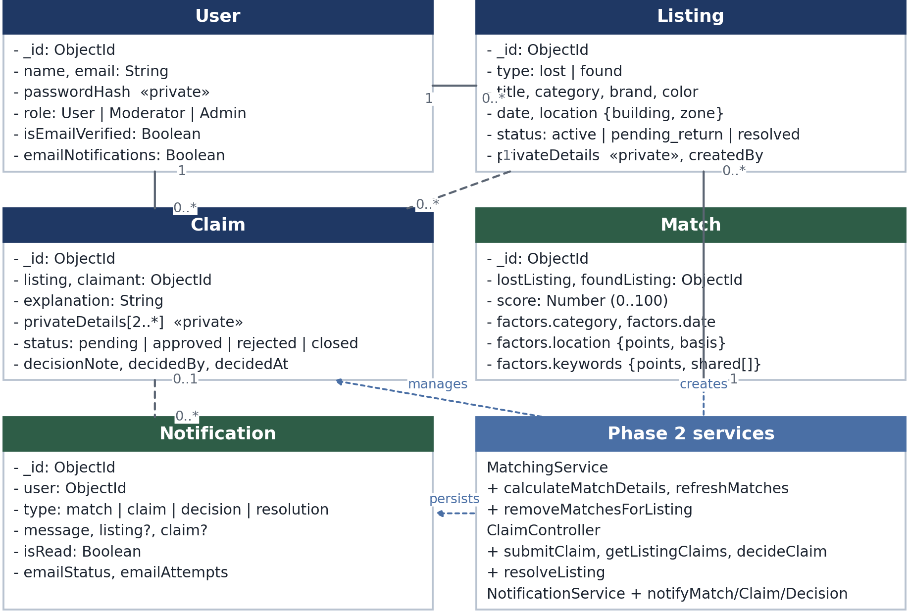
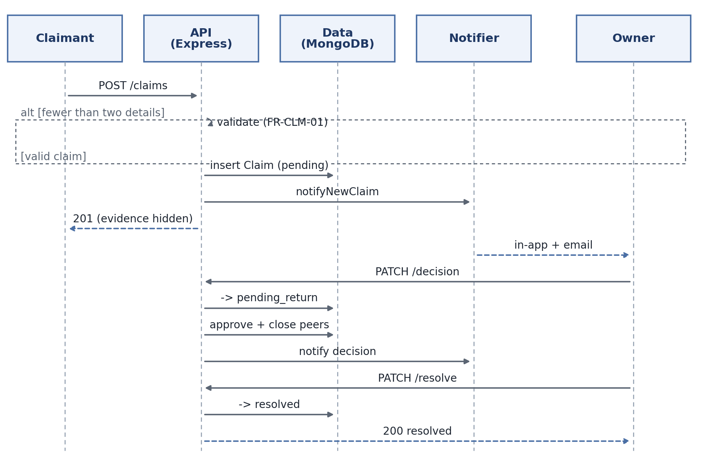
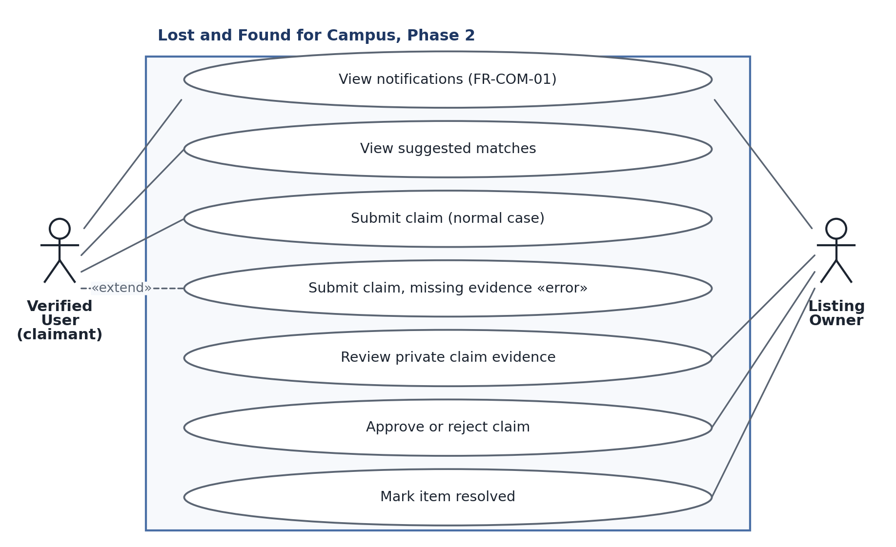

**CSCE 5430 (Fall 2026) — Deliverable 4, Project Phase 2**

# Lost and Found for Campus — Team Falcons

Waleed Mirza (1194980) · Venkata Sai Anirudh Naidu Mamidi (11908399) · Sai Sathvika Potluri (11813771) · Sai Asritha Thati (11909319)

*Source: `src/backend`, `src/frontend` · Report: `reports/deliverable-4/`*

# 1. Requirements

The Phase 2 scope is unchanged from Section 9.2 of the Deliverable 2 requirements document, so the requirements below are that set with the detail the implementation now makes possible. Phase 2 delivers the matching engine, the private claim and resolution workflow, and in-app notifications; messaging, moderation, the map, and analytics stay in Phase 3.

**Table 1. Phase 2 requirement set.**

| ID | Requirement | Implemented in |
|---|---|---|
| FR-MATCH-01 | Compare Active Lost with Active Found listings on category, date, location, and public keywords | `matchingService.js` |
| FR-MATCH-02 | Score candidates 0–100 on the specified weights and keep the contributing factors | `matchingService.js`, `Match.js` |
| FR-CLM-01 | A verified non-owner claims an Active Found listing with an explanation and two private details | `claimController.js`, `Claim.js` |
| FR-CLM-02 | Retain many pending claims; the owner approves one or rejects a claim | `claimController.js` |
| FR-CLM-03 | Approval moves the listing to Pending Return, closes competitors, and permits resolution | `claimController.js` |
| FR-COM-01 | Notify on matches, claims, decisions, and resolution; optional email never reverses an action | `notificationService.js`, `Notification.js` |

## 1.1 FR-MATCH-01 — Generating suggestions

Creating, editing, or restoring an Active listing compares it with every Active, non-deleted listing of the opposite type. Pairs scoring 65 or more are persisted as `Match` documents, pairs that no longer qualify are deleted, and all matches are removed when a listing is deleted, resolved, or moved to Pending Return. Because matches are recomputed rather than appended, an edited listing cannot keep a stale suggestion. Only the owner may read them (`GET /api/v1/listings/:id/matches`, `GET /api/v1/matches`); anyone else gets `403`.

## 1.2 FR-MATCH-02 — Scoring and explainability

Each match stores its score and the four factors behind it, so the owner sees *why* a pairing was suggested instead of an opaque number.

**Table 2. Match scoring rule (maximum 100 points).**

| Factor | Rule | Points |
|---|---|---|
| Category | Same category (case-insensitive) | 35, else 0 |
| Date | Found date within 1 day of the lost date | 25 |
| | Within 7 days | 15 |
| | More than 7 days apart | 0 |
| Location | Same building | 20 |
| | Same campus zone, different building | 10 |
| Keywords | 3 or more shared public keywords | 20 |
| | 1 or 2 shared keywords | 10 |

Only public text is compared: title, description, brand, and color. Private claim evidence is never read by the scorer, so a suggestion can be shown without leaking the answer to a claim. Text is lower-cased, stripped of punctuation and accents, stop-worded, and lightly stemmed so *wallet*/*wallets* compare equal; a pair matching on all four factors scores 100.

## 1.3 FR-CLM-01 — Submitting a claim

A verified non-owner claims an Active Found listing through `POST /api/v1/listings/:id/claims` with an ownership explanation and at least two private identifying details, such as a serial suffix or an engraved mark. The endpoint rejects an unverified account (`403`), a missing listing (`404`), a Lost listing (`400`), a listing that is not Active (`409`), the owner (`403`), an empty explanation or fewer than two details (`400`), and a duplicate open claim (`409`). Claims are limited to 30 requests per 15 minutes per client, and the `201` response returns the claim **without** its private details.

## 1.4 FR-CLM-02 — Owner decisions

A listing may hold any number of pending claims. The owner reads each claim's evidence at `GET /api/v1/listings/:id/claims` and approves one claim or rejects a claim with `PATCH /api/v1/claims/:id/decision` and a body of `{action, decisionNote}`. Only the owner may call either endpoint (`403`), and only a pending claim may be decided (`409`). Approval is guarded by a conditional update that requires the listing to still be `active`, so two simultaneous approvals cannot both succeed; the second receives `409`.

## 1.5 FR-CLM-03 — Pending Return and resolution

Approval makes three changes: the chosen claim becomes `approved`, the listing becomes `pending_return`, and every competing pending claim becomes `closed` with the note "Another claim for this listing was approved". Affected claimants are notified and the listing's suggestions are removed. After the handoff the owner calls `PATCH /api/v1/listings/:id/resolve`; resolution requires the owner, a `pending_return` listing, and an approved claim, then sets the listing to `resolved`, notifies the claimant, and deletes remaining matches.

## 1.6 FR-COM-01 — Notifications

The system persists an in-app notification for a potential match, a new claim, a decision, a competing closure, and a resolution. They are listed at `GET /api/v1/notifications` with an unread count and can be marked read individually or all at once. Each user has an `emailNotifications` preference (default on); when it is on, the service retries once and records `emailStatus` (`sent`, `skipped`, `failed`) and `emailAttempts`. Every call is wrapped so a delivery failure is logged and swallowed: a broken mail server can never roll back a claim, a decision, or a listing change.

```{=openxml}
<w:p><w:r><w:br w:type="page"/></w:r></w:p>
```

## 1.7 Constraints applied in Phase 2

**Table 3. Nonfunctional and interface requirements carried into Phase 2.**

| ID | Requirement | Satisfied by |
|---|---|---|
| NFR-SEC-03 | Validation and rate limits on claims | Field, ownership, and state checks; 30/15 min limiter |
| NFR-PRIV-01 | No private evidence in public responses or logs | `select: false`; field stripped from the create response |
| NFR-TST-01 | Tests cover authorization boundaries | 32 tests in 7 suites, including owner and state guards |
| IF-UI-03 | Claim review separates public data from evidence | Evidence only in the owner's review panel |
| IF-SW-01, IF-COM-02 | Versioned JSON endpoints behind a credential | All Phase 2 routes under `/api/v1` behind JWT `protect` |

# 2. UML Design

{width=5.4in}

{width=5.4in}

{width=5.4in}

## 2.1 Notes on the diagrams

**Class diagram.** `Match` is a persisted, scored association between one Lost and one Found listing and owns the factor breakdown of Table 2. `Claim` belongs to one listing and one claimant and holds evidence that ordinary queries exclude. `Notification` optionally references a listing and a claim so a message can be traced to its cause. A user owns zero or more listings, a listing receives zero or more claims, and a listing may appear in many matches. The lower compartment groups the Phase 2 modules rather than modelling them as classes, because they are stateless Express modules; the dotted arrows show which entity each creates or manages.

**Sequence diagram.** The `alt` fragment is the error case: with fewer than two details the API returns `400` and no state changes. Otherwise the API persists a pending claim, notifies the owner, and returns `201` without the evidence. The lower half re-checks ownership, claim state, and listing state before moving the listing to `pending_return`, approving the chosen claim, closing its competitors, notifying everyone affected, and dropping the matches. The last exchange marks the item `resolved`; dashed arrows are responses, labelled with the status the client receives.

**Use case diagram.** The verified user views suggestions for their own listings and submits a claim (**normal case**). The **error case** is *Submit claim with missing evidence*, which `«extend»`s the normal claim because it is the same interaction entered with invalid input. The owner reviews private evidence, approves or rejects a claim, and marks the item resolved, and both actors receive notifications. Because the decision controls sit inside each claim's evidence panel, an owner cannot decide a claim they have not been shown.

# 3. Coding and AI Usage Report

## 3.1 What was generated by AI and what was done by the team

Phase 2 code was drafted with an AI assistant and then reviewed, corrected, and tested by team members. No Phase 2 file was accepted without being run.

**Table 4. Authorship by component.**

| Component | AI-generated | Team work |
|---|---|---|
| `Claim`, `Match`, `Notification` models | Schemas, indexes, validators | Field selection, two-detail validator, evidence kept `select: false` |
| `matchingService.js` | Scoring, keyword normalization, refresh routine | Factor audit against FR-MATCH-02, lifecycle wiring, stale-match cleanup |
| `claimController.js` | Handlers and validation branches | Atomic approval guard, competing closure, redaction, error isolation |
| `notificationService.js`, `emailService.js` | Persistence, fan-out, retry loop | Preferences, delivery bookkeeping, swallowing failures |
| Controllers, routes, React views, tests | Scaffolding, layout, fixtures | Ownership checks, `/api/v1` mounting, owner-only controls, privacy assertions |

## 3.2 AI usage report

**Tools and tasks.** Claude (Anthropic, Sonnet family, via claude.ai and an editor agent) and ChatGPT drafted schema and controller scaffolding, the scoring functions, claim-panel React state, test fixtures, and this report's structure. Every output was reviewed by a team member before it was kept.

**Representative prompts.** *"Implement FR-MATCH-02 exactly as written, and store the factor breakdown with each match."* · *"Add an owner-only endpoint returning pending claims with private evidence, and keep the evidence out of the create-claim response and every public payload."* · *"Approval must not be racy: only one approval may succeed even if the owner double-clicks."* · *"Wrap notification and email failures so a claim action is never rolled back."*

**Mistakes the AI produced, and the fixes.**

1. *Matching was implemented but never called.* It passed its unit test while no route imported it. Fixed by calling `refreshMatchesForListing` after create and edit and `removeMatchesForListing` after delete and resolution.
2. *Notifications were fabricated in memory.* They vanished on restart. Fixed by persisting `Notification` documents and adding list and read endpoints.
3. *Email failure reversed successful actions.* The paths awaited the mail transport, so an SMTP error returned `500` after the write. Fixed by isolating delivery, retrying once, and never propagating the error.
4. *Approval was racy.* The handler read the listing and then updated it. Fixed with a conditional `findOneAndUpdate` on `status: "active"`.
5. *Private evidence leaked and tests shared a database.* The create response returned `privateDetails`, and suites deleted each other's data. Fixed with `select: false`, a response field strip, `MONGODB_URI_TEST`, and `maxWorkers: 1`.

# 4. Test Cases

Phase 2 is covered by 32 Jest/Supertest cases in 7 suites, run against a dedicated `lost_and_found_test` database with one worker.

**Table 5. Phase 2 and regression test cases.**

| # | Test case | Input | Expected result |
|---|---|---|---|
| 1 | Strong pair | Same category, 1 day, same building, 3 keywords | Score 100 |
| 2 | Claim happy path | Verified non-owner, explanation, 2 details | `201`, `pending`, no `privateDetails` |
| 3 | Owner cannot claim | Owner claims own listing | `403` |
| 4 | Insufficient evidence | One private detail | `400` |
| 5 | Duplicate claim | Second pending claim by the same user | `409` |
| 6 | Non-Active listing | Listing in `pending_return` | `409` |
| 7 | Evidence owner-only | Owner fetches listing claims | `200`, both details present |
| 8 | Approval closes competitors | Two pending claims, approve one | Approved, other `closed`, listing `pending_return` |
| 9 | Second decision blocked | Decide an already-decided claim | `409` |
| 10 | Resolution requires approval | Resolve with no approved claim | `409` |
| 11 | Resolution happy path | Owner resolves after approval | `200`, `resolved`, claimant notified |
| 12 | Notification persisted | Email disabled | Stored, `isRead: false`, `emailStatus: not_requested` |
| 13 | SMTP not configured | Email enabled, no SMTP | `emailStatus: skipped`, action succeeds |
| 14 | Regression: bad date range | `dateFrom` after `dateTo` | `400`, not an empty page |

**Result: 7 suites, 32 tests, 32 passing.** A live API smoke test exercised match, competing claims, approval, closure, resolution, notifications, and email preference: 27 of 27 checks passed. The frontend passed a production build and a lint run with 0 errors.

# 5. User Manual (Phase 2 Features)

**Suggested matches.** Open one of your own listings. The *Potential matches* panel shows each suggestion's score and a per-factor breakdown.

**Claiming a found item.** Open an Active Found listing and select *Claim this item*. Explain why the item is yours and enter at least two private details, such as a serial suffix; the owner alone sees them. The claim appears under *My Claims* as *Pending*. You cannot claim your own or a Lost listing, an inactive item, or the same item twice.

**Reviewing claims and resolving.** As the owner, open your Found listing. The *Claims* panel lists each claim with the claimant's name, explanation, and private evidence. *Approve* asks for confirmation because it closes every other pending claim; *Reject* records a decision note. Approval moves the listing to *Pending Return*; after handing the item over, *Mark Resolved* makes it *Resolved*, removes it from search and matches, and notifies the claimant.

**Notifications.** The bell shows your unread count. *Notifications* lists every event, newest first; select one to mark it read, or use *Mark all read*. The *Email notifications* switch turns email off but keeps in-app notifications; if the mail server is down the notification is still recorded and your action still succeeds.

# 6. Compilation and Run Instructions

**Prerequisites.** Node.js 20 or later, Git, and MongoDB 7 (local or Docker) at `mongodb://127.0.0.1:27017`.

```
git clone <repository-url>
cd csce5430-falcons-lostandfoundapp
docker run -d --name lostfound-mongo -p 27017:27017 mongo:7
```

**Backend.** Copy `.env.example` to `.env` and set `PORT=5000`, `MONGODB_URI=mongodb://127.0.0.1:27017/lost_and_found`, `MONGODB_URI_TEST=mongodb://127.0.0.1:27017/lost_and_found_test`, `JWT_SECRET`, `APP_BASE_URL`, and `CLIENT_ORIGIN` (`http://localhost:5173`). `SMTP_*` is optional; without it emails are recorded as `skipped` and in-app notifications still work.

```
cd src/backend && npm install && cp .env.example .env && npm run dev   # API :5000
cd src/frontend && npm install
echo "VITE_API_BASE_URL=http://localhost:5000" > .env && npm run dev   # Vite :5173
```

**Verify.** `curl http://127.0.0.1:5000/api/v1/health` must return `200`. Create a Found and a Lost listing with the same category, building, and a nearby date; the Lost listing should show a match above 65 points.

**Tests.** MongoDB must be running and `MONGODB_URI_TEST` must point at a disposable database; the suite clears its own data and never touches the development database.

```
cd src/backend && npm test          # or: npx jest --runInBand
cd ../frontend && npm run build && npm run lint
```

Expected: 7 suites, 32 tests passing, a clean production build, and no lint errors.

# 7. Code Inspection Feedback

The Phase 2 code-inspection session had not taken place when this report was written, so this section does not invent remarks. **From the Deliverable 3 inspection.** Reviewers asked for clearer separation between public listing data and claim evidence, now enforced in the schema rather than only the interface; for the matching and notification modules to be reachable from real routes instead of unused drafts, now wired into the listing and claim flows; and for tests covering authorization boundaries, which now assert owner/non-owner, verified/unverified, and state-transition failures.

**From the Deliverable 2 workshop.** The workshop asked for a defined lifecycle (Active, Pending Return, Resolved), a claim step separate from messaging, and a rule that email failure must not break a workflow. All three are in Sections 1.5 and 1.6.

**Outstanding.** Written feedback from the Phase 2 inspection will be appended here, with the action taken for each remark.

# 8. Reflection

Phase 2 is the first increment where the project behaves like a product rather than a set of screens. A Lost listing produces scored, explainable suggestions; a stranger can prove ownership without publishing the proof; the owner decides once and only once; and the losing claimants are told why. Storing the *factors* next to the score cost one small schema and made the feature testable and defensible.

What went well: the requirement text was precise enough to implement literally, so the scoring table, status names, and error codes map one-to-one onto the code and tests. Keeping email failures out of the transactional path removed a class of "the claim succeeded but the user saw an error" bugs.

What could be improved: two modules were written before they were connected, which produced a false sense of progress until a live run showed that no match was ever stored; a feature must be wired to a route the day it is written. Approval needed a second pass to become race-safe, and the frontend still has no automated tests, the largest gap before Phase 3.

# 9. Member Contribution Table

**Table 6. Contribution by member.**

| Member | Contribution | Overall (%) |
|---|---|---|
| Waleed Mirza | Coordinated the phase; authored the requirements, UML notes, AI usage, inspection, and reflection sections; verified the end-to-end chain | 30% |
| Venkata Sai Anirudh Naidu Mamidi | Implemented the backend models, controllers, routes, matching, notification, and email services | 30% |
| Sai Sathvika Potluri | Produced the three UML diagrams; reviewed the claim and notification screens; contributed to the user manual | 20% |
| Sai Asritha Thati | Implemented the frontend; authored the test cases; ran the automated suites and the manual pass | 20% |
| **Total** | | **100%** |
